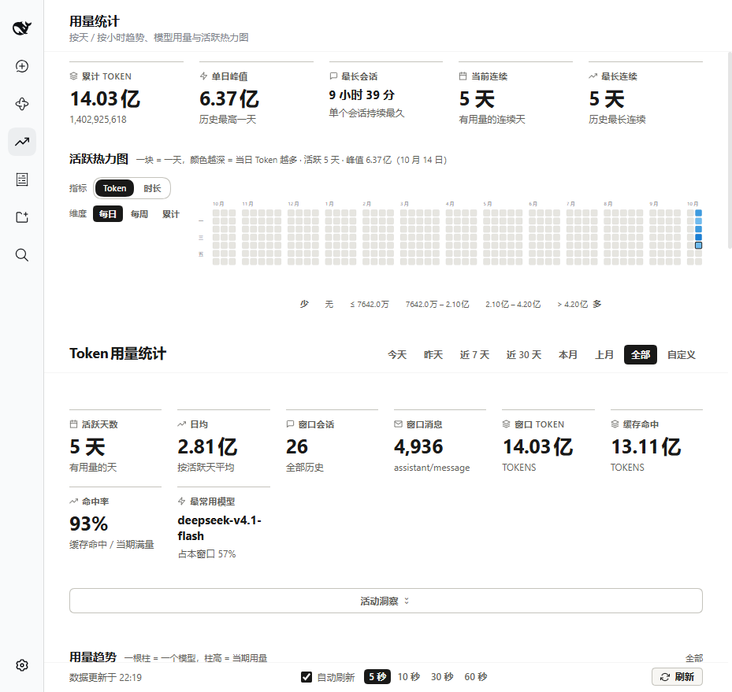
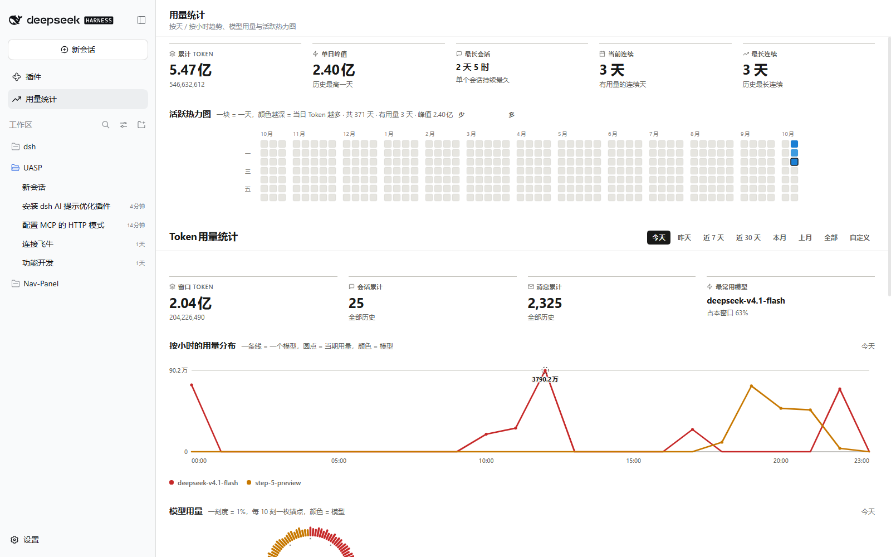
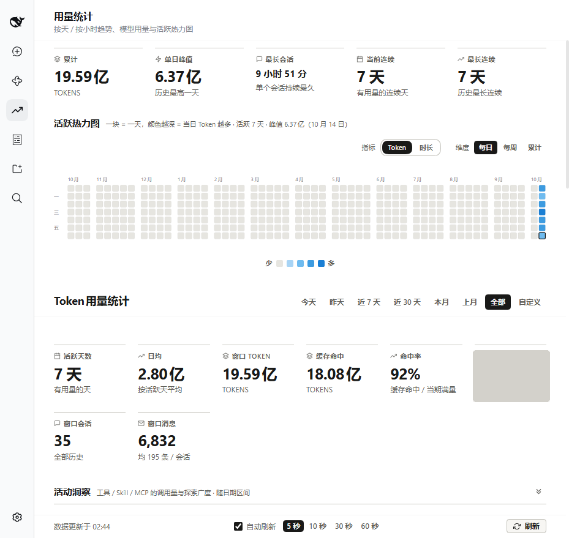
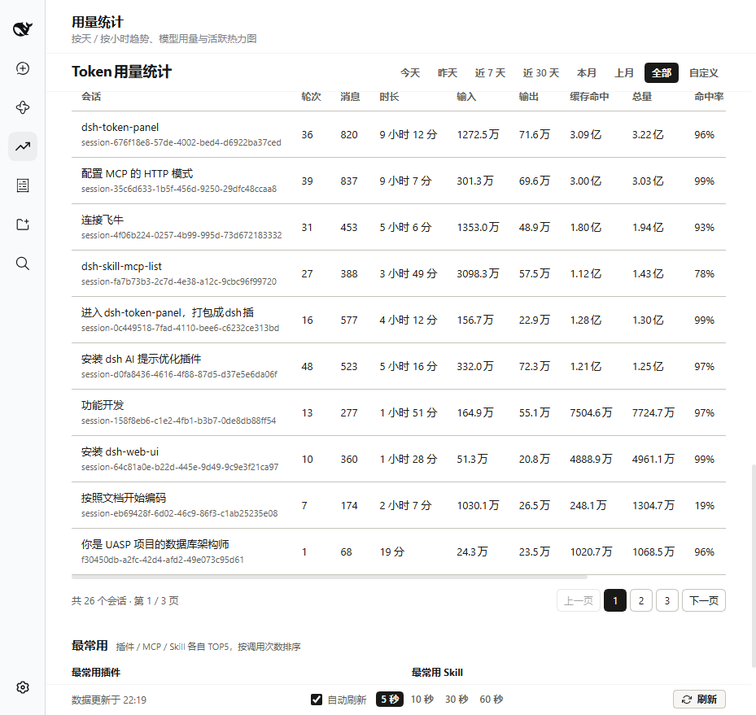
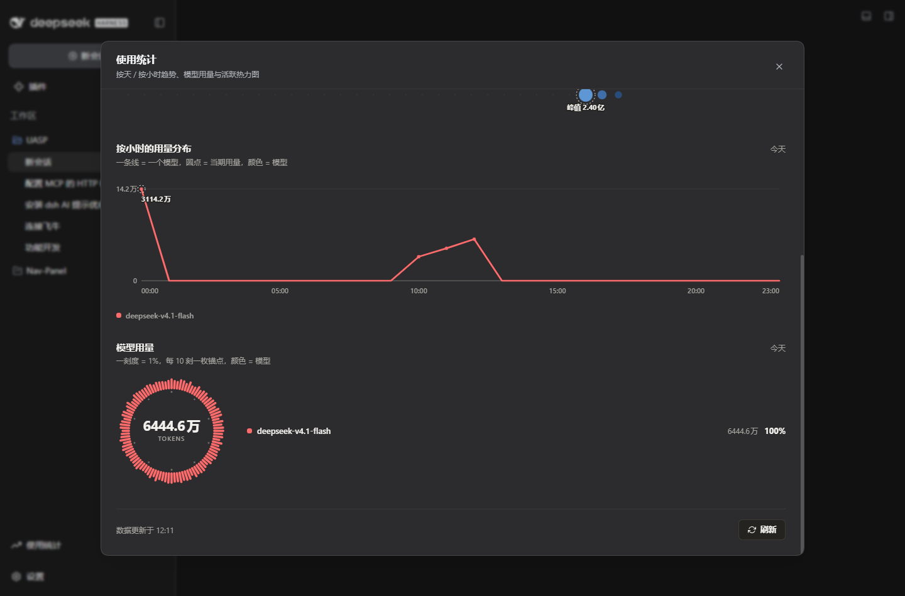

# dsh-token-panel

<div align="center">

**DeepSeek Harness (DSH) plugin: sidebar Token usage statistics**

**Covers: full-history session scan × usage trend × model dial × activity heatmap × session & provider breakdown × light/dark themes**

[](package.json)
[](#installation)
[](#design--implementation)
[](#license--credits)

**English** | [简体中文](README.md)

</div>

---

A "Token ledger" built into the DSH sidebar. It scans your DSH session records and accounts for every token by day, hour, model, session, and provider: how much you used today, which model costs the most, and which day was the peak. **Fully local scanning, aggregation, and rendering** — your data never leaves your machine.

> ⚠️ Unofficial community plugin, not affiliated with DeepSeek.

## 📸 Preview

| Menu entry | Main view |
|:---:|:---:|
|  |  |

| Trend tooltip | Session & provider tables |
|:---:|:---:|
|  |  |

Dark theme: 

## ✨ Features

| Module | Description |
|------|------|
| 🧭 **Native menu** | A native menu row directly below "Plugins" in the sidebar, styled exactly like the built-in entries; clicking it opens a main-area page |
| 📅 **Time range** | Today / Yesterday / Last 7 days / Last 30 days / This month / Last month / All / Custom (with start–end validation); **defaults to Today**; the date bar freezes flush against the title while scrolling, and every query below it follows the selected range |
| 🔥 **Activity heatmap** | GitHub contribution grid: week columns × weekday rows, five color levels by daily usage, months separated by gaps, covering the last year |
| 📈 **Usage trend** | One line per model, dots for the current period, peaks labelled; the hover tooltip follows the mouse; legend toggles series |
| 🍩 **Model usage** | Dial gauge: 100 ticks = 100%, an anchor every 10 ticks; occupies 40% width, and the breakdown beside it lists **cache hits and hit rate** |
| 📊 **Session stats** | Per session: name / turns / messages / tokens / cache hits / hit rate / share / model breakdown / last activity, **paginated beyond 10 rows** |
| 🔌 **Provider stats** | Aggregated by API provider: input / output / cache hits / hit rate / total / share / model breakdown; **click any row** for that provider's per-model usage and hit rate, **paginated beyond 10 rows** |
| 🧮 **Top metrics** | Total tokens / peak day / longest session / current streak / longest streak |
| ♻️ **Auto refresh** | On by default at 5 seconds (options: 5 / 10 / 30 / 60 seconds) |
| ♿ **Accessibility** | WCAG AA contrast (audited per theme), `prefers-reduced-motion` fallback, transparent hit areas so even small dots are easy to hover |

## 📦 Installation

Requires `@deepseek-ai/dsh` (plus `pnpm`, which the DSH plugin command depends on).

```bash
dsh plugin --profile web add dsh-token-panel
```

Local development install:

```bash
dsh plugin --profile web add link:/path/to/dsh-token-panel
```

Restart DSH, then click **用量统计** in the sidebar.

## 🚀 Usage

- Switch the time range at the top; **All** shows everything since you started.
- Hover the trend chart for per-model figures; click the legend to toggle a model.
- Pagination controls appear under the session and provider tables beyond 10 rows.
- **Refresh** forces a full rescan; auto refresh pulls every 5 seconds by default.

## ⚙️ How it works

```
DSH session records
        │
        ▼  sessionPersistence enumeration + event replay
Aggregate by day / hour / model / session / provider
        │
        ▼  in-memory + on-disk two-tier cache (SWR)
GET /api/usage-stats (host trust fence: Host/Origin + cookie)
        │
        ▼
Client: hand-written SVG rendered 1:1 at the measured container width
```

## 🎨 Design & implementation

| Point | Notes |
|--------|------|
| **Menu** | Registers the `sidebar.panellist` and `main` slots, reusing DSH's native `panelRow` structure so the style matches built-in entries |
| **Charts** | Hand-written SVG (GitHub grid / stacked bars / dial ring), zero runtime chart libraries |
| **Palette** | Two-track palette: categorical hues carry model identity, an ordinal lightness ramp carries magnitude; both themes meet WCAG AA |
| **Typography** | Fixed px type scale plus a 4px spacing ladder; charts render 1:1 at the ResizeObserver-measured width |
| **Hit areas** | Visual elements carry no events: per-cell transparent rects on the heatmap, full-ring sector paths on the dial, so hovering never flickers |
| **Tooltip** | `position: fixed` mounted under a container without `transform`, so coordinates stay viewport-relative and follow the mouse |
| **Server** | Reuses the host `sessionPersistence` for aggregation; two-tier cache with stale-while-revalidate |
| **Security** | `/api/usage-stats` passes the host `connection.requestRejection` trust fence; read-only, never writes back to session logs |

## 🔢 Data semantics

| Metric | Definition |
|------|------|
| Token usage | Taken from the full `usage` payload on `assistant/message` events (input + output + cacheRead + cacheWrite), deduplicated by `turn:step` |
| Turns | Counted from `step/end` events per new turn (covers completed / failed / cancelled) |
| Model attribution | The message's own `model` first, then `request/context`, then folded into `other` |
| Provider attribution | The `provider` field on `request/context` events, folded into `other` when absent |
| Session attribution | Accumulated per session file; only sessions with usage are listed |
| Active day | A day with at least one usage event; streaks are derived from adjacent active days |

## ✅ Acceptance tests

```bash
node tests/run-acceptance.mjs            # static assertions + headless browser E2E
node tests/run-acceptance.mjs --static   # static assertions only
```

The browser phase boots `dsh web` on a random port, drives real Chrome to assert the menu, page rendering, pagination, tooltip and chart behaviour, then shuts the instance down.

## 🤝 Compatibility

- Built and verified against DSH `0.2.0-rc.2`.
- Requires the host `sessionPersistence`, `webServer` and `connection` services, plus the `@deepseek-ai/dsh-client-ui-slots` client runtime.
- Node.js `>= 20`; works with both the web and desktop profiles.

## 🗂️ Repository layout

<details>
<summary><b>Directory tree</b> (click to expand)</summary>

```
dsh-token-panel/
├── package.json          # Plugin manifest (dsh client injection declarations)
├── cordis.patch.yml      # DSH patch declaration
├── lib/
│   ├── index.mjs         # Host side: session scan, aggregation, /api/usage-stats
│   └── client.js         # Browser side: menu, page, charts (build output)
├── build/
│   ├── body.js           # Client source (with the __CSS__ placeholder)
│   ├── panel.css         # Stylesheet source
│   └── assemble.cjs      # Build: body.js + panel.css -> lib/client.js
├── tests/
│   ├── run-acceptance.mjs  # Acceptance entry (static + browser)
│   ├── browser-e2e.mjs     # Browser E2E assertions
│   ├── contrast.cjs        # Contrast audit
│   └── preset-conformance.cjs
├── assets/               # Screenshots
├── LICENSE               # MIT
└── README.md / README.en.md
```

</details>

## 📄 License & credits

MIT License.

Based on [Amer-CN/zcode-usage-stats](https://github.com/Amer-CN/zcode-usage-stats) (MIT), reworked from a **settings page** into a **native sidebar menu plus main-area page**, with a GitHub-style heatmap, session and provider breakdowns, pagination, and auto refresh added.

