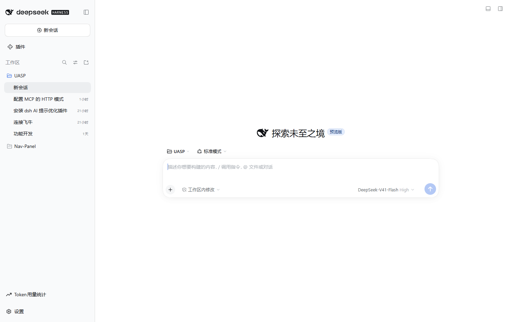

# dsh-token-panel

DeepSeek Harness 的**侧边栏 Token 用量面板**：在左侧边栏底部（设置按钮旁）增加「**Token 用量统计**」入口，点击后弹出统计面板。

面板内容：按天 / 按小时趋势图、模型用量刻度环、活跃热力图，支持 **今天 / 昨天 / 近 7 天 / 近 30 天 / 本月 / 上月 / 全部 / 自定义** 区间。**默认展示今天。**

- **活跃热力图**为 GitHub 贡献网格风格，固定展示最近一年，五档色阶按当日用量着色。
- 统计周期只有一天时，自动隐藏「活跃天数」「日均」两张恒定卡片。
- 模型刻度环占 **40%** 宽，模型明细占 **60%**，并排展示。
- 日期选择栏滚动时冻结在标题下方。
- 底部新增**会话统计**（含各会话内模型明细）与**供应商用量统计**两张表格。
- 底部提供**自动刷新**开关，默认开启、默认 **5 秒**（可选 5 / 10 / 30 / 60 秒）。

## 效果图

### 侧边栏入口

设置按钮上方的「Token 用量统计」即为本插件入口——与左下角用户菜单**同宽同高、图标左对齐**：



### 统计面板 · 浅色主题


### 统计面板 · 深色主题

自动跟随 DSH 主题切换：


### 会话统计与供应商用量

底部两张表格：会话维度（含模型明细）与供应商维度：


> 本项目基于 [Amer-CN/zcode-usage-stats](https://github.com/Amer-CN/zcode-usage-stats)（MIT）改造：
> 将原本挂在**设置页**的视图改为**侧边栏弹窗**，槽位与交互对齐 [dsh-token-usage](https://www.npmjs.com/package/@zerro223/dsh-token-usage) 的展示方式。

## 安装

```bash
dsh plugin --profile web add dsh-token-panel
```

包声明了 `dsh.bundle.patch`，安装后会自动并入 profile 的层栈，无需手工编辑 `cordis.patch.yml`。装完**重启 DSH** 生效。

本地开发安装：

```bash
dsh plugin --profile web add link:/path/to/dsh-token-panel
```

## 验收测试

```bash
node tests/run-acceptance.mjs            # 静态断言 + 无头浏览器端到端（53 项）
node tests/run-acceptance.mjs --static   # 仅静态断言
```

浏览器阶段会自行启动 `dsh web`（随机端口）、驱动真实 Chrome 断言侧边栏入口与弹窗行为，然后关闭实例。

## 环境要求

| 项 | 要求 |
|---|---|
| DeepSeek Harness | `0.2.0-rc.2`（已验证） |
| Node | `>= 20` |
| 平台 | web / desktop profile（两者通用） |
| 运行时依赖 | 无 |

## 工作原理

- **宿主侧**（`lib/index.mjs`）：注册 `GET /api/usage-stats`，只读扫描 `$DSH_HOME/sessions` 下的会话日志，按天 / 按小时 / 按模型聚合 Token 用量。带内存 + 磁盘缓存与 SWR（先返回旧数据、后台异步刷新）。**永不写回会话日志。**
- **浏览器侧**（`lib/client.js`）：注册 `sidebar.footer.action` 槽位（id `usage-stats`，order 31），点击弹出面板。遮罩点击 / Esc / 关闭按钮三种方式关闭。

## 与上游的差异

| | 上游 zcode-usage-stats | 本项目 |
|---|---|---|
| 挂载位置 | 设置页 `settings.section` | 侧边栏 `sidebar.footer.action` |
| 展示方式 | 设置页内嵌视图 | 弹窗（遮罩 + 面板） |
| 包名 / 模块 id | `zcode-usage-stats` | `dsh-token-panel` |
| peer 声明 | 含已移除的 `dsh-client-runtime` | 仅声明 0.2 实际存在的包 |
| 测试 | 无 | 53 项验收断言 |

## License

MIT
